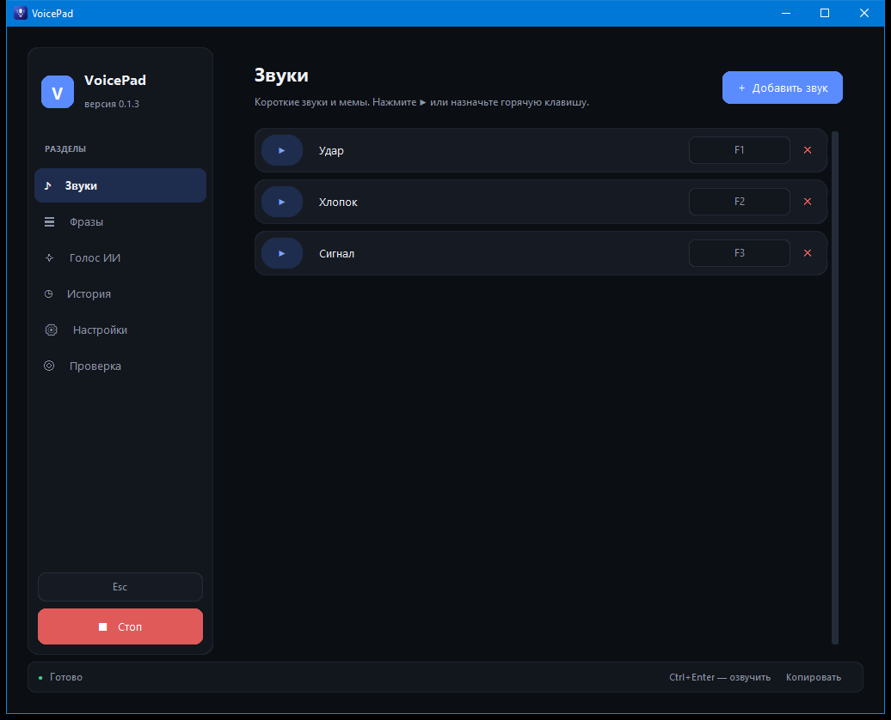
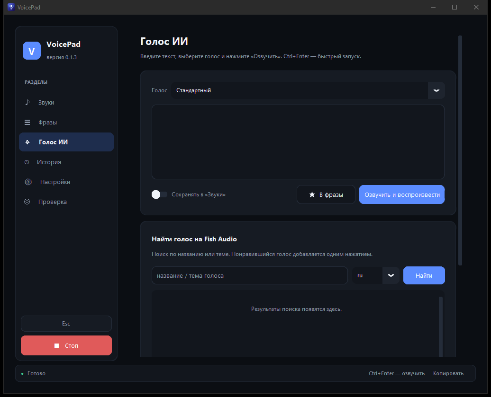
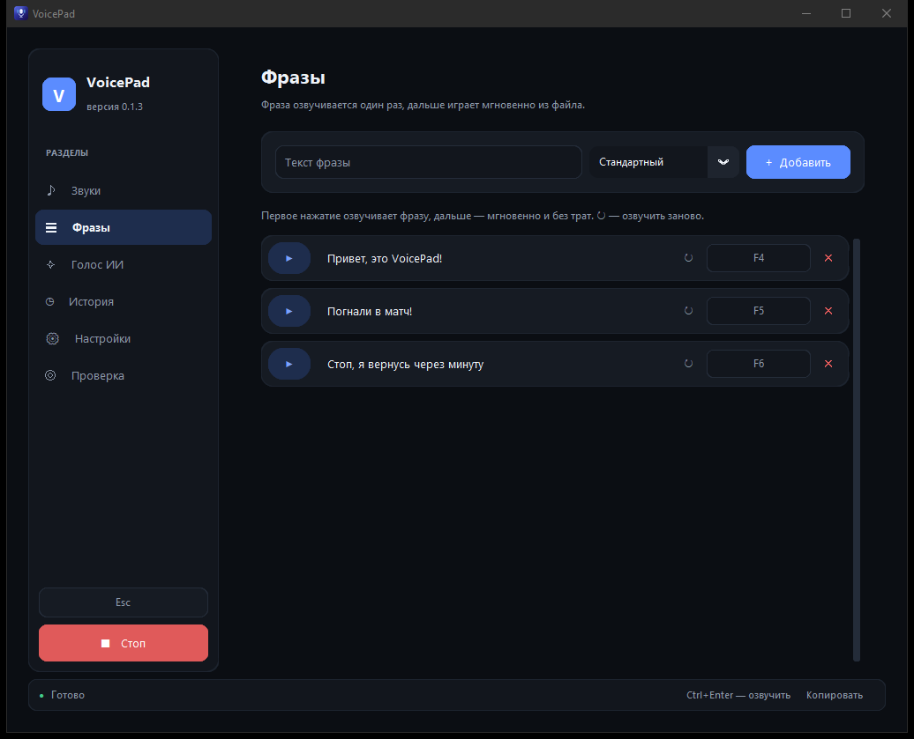
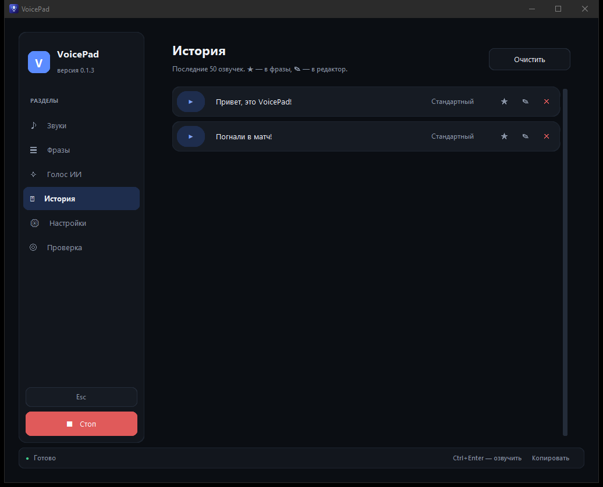
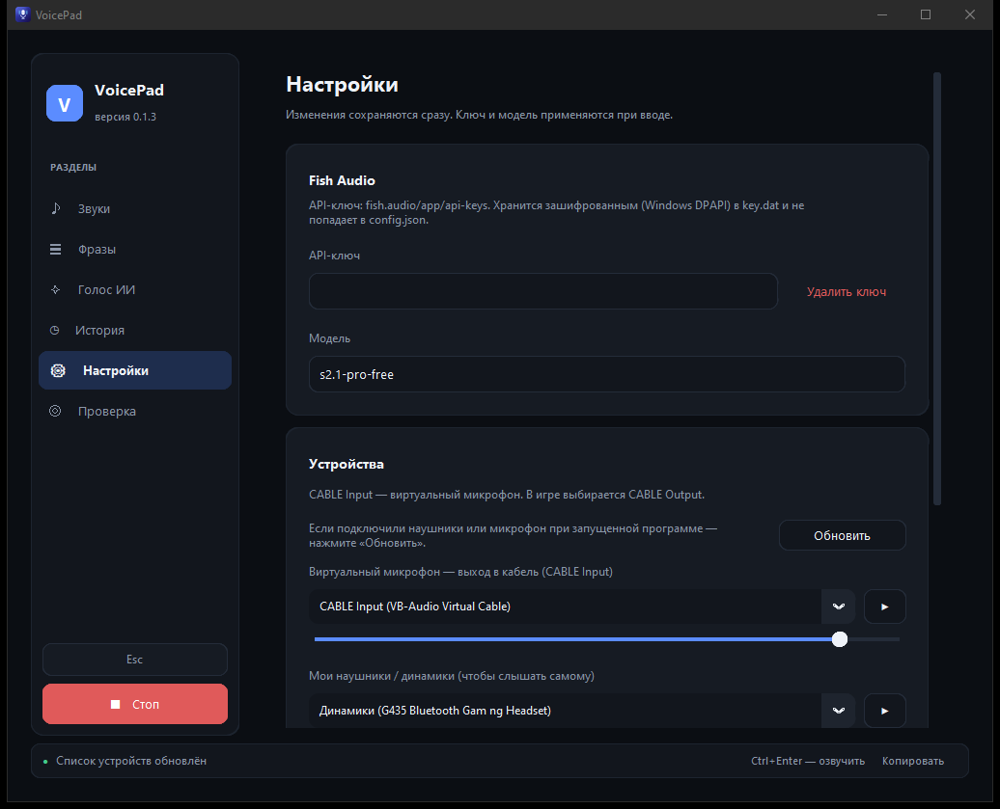
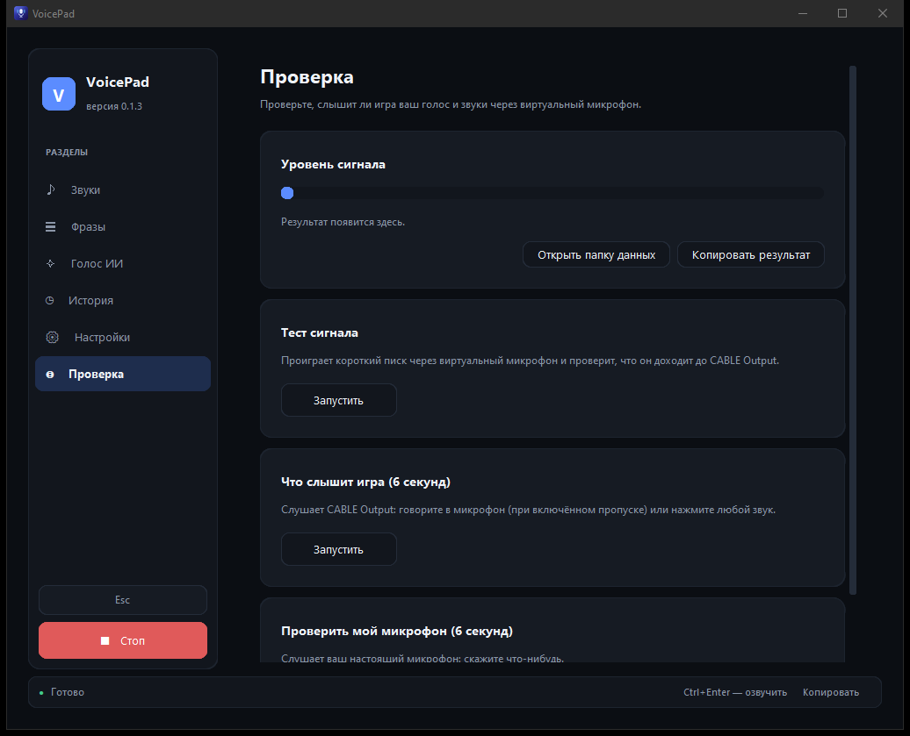

# VoicePad

Саундпад для Windows с озвучкой текста нейросетью. Пишете фразу, нажимаете кнопку — и голос звучит в игре или Discord через виртуальный микрофон, а также в ваших наушниках.

## Статус: закрытая бета

Приложение работает и проходит закрытое тестирование. **Публичных сборок пока нет**: доводим до стабильности интерфейс, установку и работу с аудиоустройствами, поэтому ссылок на скачивание здесь нет.

О выходе публичной версии сообщим в этом репозитории. Следить за разработкой можно по истории коммитов и разделам ниже.

## Возможности

- **Звуки** — загрузка своих файлов (wav, mp3, ogg, flac), глобальные горячие клавиши, кнопка «Стоп».
- **Голос ИИ** — текст превращается в речь через [Fish Audio](https://fish.audio), поиск голосов прямо в программе.
- **Фразы** — быстрые кнопки с готовыми фразами. Первое нажатие озвучивает, дальше фраза играет мгновенно из сохранённого файла.
- **История** — последние 50 озвучек, любую можно проиграть снова без повторной траты кредитов.
- **Проверка** — вкладка, где можно убедиться, что игра вас слышит: тестовый писк через виртуальный микрофон, индикатор «что слышит игра» и проверка вашего настоящего микрофона. Показывает уровень сигнала и подсказывает, что поправить.
- Звук идёт одновременно в виртуальный микрофон и в ваши наушники, у каждого своя громкость.
- Опционально: пропуск вашего реального микрофона, чтобы в игре слышали и вас, и звуки.

## Скриншоты

Снимки сделаны в демо-режиме (`tools/demo_capture.py`) с вымышленными фразами — без реальных настроек и API-ключа.

<table>
  <tr>
    <td></td>
    <td></td>
  </tr>
  <tr>
    <td></td>
    <td></td>
  </tr>
  <tr>
    <td></td>
    <td></td>
  </tr>
</table>

## Как это работает

1. Если виртуального микрофона нет, программа предложит установить бесплатный [VB-CABLE](https://vb-audio.com/Cable/) одной кнопкой. Программа скачает архив только с официального сайта VB-Audio, проверит цифровую подпись установщика и покажет подтверждение перед запросом прав администратора. После установки её нужно перезапустить.
2. В «Настройках» вставляется API-ключ с [fish.audio/app/api-keys](https://fish.audio/app/api-keys) и выбираются устройства:
   - виртуальный микрофон: `CABLE Input`;
   - наушники или динамики: ваши обычные.
3. В игре или Discord в качестве микрофона выбирается `CABLE Output`.
4. В разделе «Голос ИИ» пишете текст и нажимаете «Озвучить и воспроизвести» (или Ctrl+Enter).

### Про API-ключ и стоимость

Для озвучки нужен личный ключ Fish Audio, у каждого пользователя свой. У Fish Audio есть бесплатный API-режим (модель `s2.1-pro-free`, она стоит в настройках по умолчанию) и бесплатный тариф аккаунта только для личного использования. Актуальные условия и лимиты — на fish.audio. Свои загруженные звуки работают без ключа и без интернета.

### Если что-то не работает

- В игре не слышно звука: откройте раздел «Проверка» и запустите «Тест сигнала». Также проверьте, что в игре выбран `CABLE Output`, а в настройках VoicePad выход стоит на `CABLE Input`.
- Ошибка `402` при озвучке: на аккаунте Fish Audio закончился баланс.
- Ошибка `401`: неверный API-ключ.
- Не срабатывают горячие клавиши в игре: некоторые игры с античитом блокируют глобальные хоткеи — нажимайте кнопки в окне программы.
- Любая ошибка показывается в строке статуса внизу окна и записывается в файл `%USERPROFILE%\.voicepad\error.log`. Если что-то сломалось, пришлите его текст.
- Пропуск микрофона добавляет задержку около 100–200 мс. Если мешает, отключите его и собирайте микс через Voicemeeter.

## Данные программы

Настройки, список голосов и готовые WAV-файлы лежат в папке `%USERPROFILE%\.voicepad`. API-ключ **не пишется в `config.json`**: он шифруется через Windows DPAPI и хранится в `key.dat`, доступном только вашей учётной записи. Кнопка «Удалить ключ» в «Настройках» стирает его с компьютера. Если ключ остался в старом `config.json`, при первом запуске программа перенесёт его в зашифрованное хранилище.

Текст фразы и ключ отправляются на серверы Fish Audio — без этого синтез речи невозможен. VoicePad не собирает телеметрию, не показывает рекламу и никуда больше не передаёт ваши данные. История и аудиофайлы остаются на диске.

Горячие клавиши работают с большинством приложений, но игры с античитом и программы с собственным захватом ввода могут их блокировать — в этом случае пользуйтесь кнопками в окне VoicePad.

## Удаление

Через «Установка и удаление программ» или программой `unins000.exe` в папке VoicePad (ярлык «Uninstall VoicePad» есть и в меню «Пуск»). Перед удалением закройте VoicePad. Деинсталлятор спросит, нужно ли удалить VB-CABLE (если его установила программа) и ваши настройки с озвученными фразами. Если VB-CABLE у вас стоял и раньше, он не трогается.

Портативная сборка ничего не регистрирует в системе: для удаления достаточно удалить папку. Если вы ставили через неё VB-CABLE, сначала нажмите «Удалить VB-CABLE» в «Настройках».

VB-CABLE, установленный программой, хранится в подпапке `vbcable` рядом с `VoicePad.exe`.

## Запуск из исходников

Нужен Python 3.12 для Windows.

```
pip install customtkinter sounddevice soundfile numpy requests keyboard
python voicepad.py
```

Это вариант для опытных пользователей: без поддержки и без гарантий.

## Сборка

- `build.bat` — exe через PyInstaller (`--onefile --noconsole`, иконка `voicepad.ico`).
- `build_installer.bat` — exe и установщик, нужен [Inno Setup 6](https://jrsoftware.org/isdl.php).
- CI (`.github/workflows/build.yml`) собирает оба файла при публикации релиза.

## Лицензия и обратная связь

Код VoicePad распространяется под [MIT](LICENSE). Сторонние зависимости и VB-CABLE имеют собственные лицензии и не являются частью проекта.

Проект для Windows 10/11. Ошибки и предложения — в [Issues](https://github.com/v1sor781/voicepad/issues).
